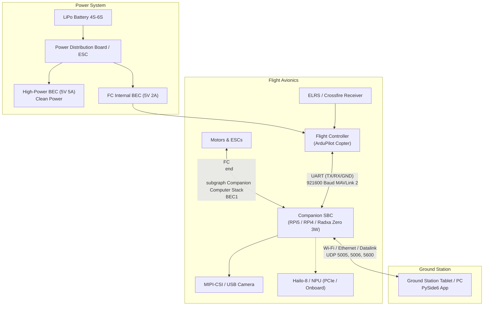

# InterceptorV2 — Hardware Wiring & User Operation Guide

This guide covers complete hardware wiring, circuit diagrams, configuration, and step-by-step operating instructions for the **InterceptorV2 Autonomous FPV Target Tracker**.

Supported Single Board Computers (SBCs):
1. **Raspberry Pi 5** (Flagship: Hailo-8 / 8L NPU via PCIe M.2 HAT, 30+ FPS YOLOv8)
2. **Raspberry Pi 4B** (Mid-tier: CPU ONNX or USB NPU fallback)
3. **Radxa Zero 3W** (Ultralight / Sub-250g: Rockchip RK3566 with integrated NPU)

---

## 1. Safety Rules (§1 Invariants)

Before applying power, remember the fundamental safety rules enforced by the architecture:
- **Rule S1:** The companion computer **never arms or disarms the drone**. Arming and disarming are performed exclusively by the pilot via the RC transmitter.
- **Rule S6 (Instant Pilot Override):** The moment you flip your flight mode switch on the RC transmitter away from `GUIDED` (e.g., to `ALT_HOLD`, `STABILIZE`, or `POSHOLD`), the companion computer instantly ceases all velocity setpoints. The pilot has 100% control at all times.
- **Rule S4 (Target Lost):** If target tracking is lost for > 1.0s, the drone hovers in place. If not re-acquired after 5.0s, it requests `LOITER` and alerts the pilot.
- **Rule S5 (GCS Link Lost):** If GCS telemetry drops for > 2.0s, the drone hovers. After 10.0s, it triggers `RTL` (Return to Launch).

---

## 2. Power & System Architecture Overview



> [!WARNING]
> **Ground Loop & Power Isolation:**
> - Connect the companion computer's **GND** to the Flight Controller's **GND**.
> - **DO NOT connect the 5V power output of the Flight Controller to the companion computer**. The companion computer draws up to 3A–5A, which will burn out the FC's onboard regulator. Power the companion computer strictly from a dedicated 5V 5A UBEC.

---

## 3. Wiring & Circuit Diagrams per SBC

### Option A: Raspberry Pi 5 (Recommended)

The Raspberry Pi 5 provides hardware PCIe Gen 3 for the Hailo-8/8L M.2 AI HAT, running YOLOv8 at 30+ FPS with minimal CPU load.

```
       ┌────────────────────────────────────────────────────────┐
       │                Raspberry Pi 5 Pinout                   │
       │                                                        │
       │   [ 2] 5V  In <───────── +5V from 5A UBEC              │
       │   [ 4] 5V  In <───────── +5V (tie together for high A) │
       │   [ 6] GND    ────────── Common Ground (UBEC + FC GND) │
       │   [ 8] GPIO 14 (TXD0) ──> FC TELEM RX                  │
       │   [10] GPIO 15 (RXD0) <── FC TELEM TX                  │
       │                                                        │
       │   [PCIe 16-pin FFC] ────> Raspberry Pi AI HAT (Hailo-8)│
       │   [CAM0 22-pin FFC] ────> Raspberry Pi Camera Module 3 │
       └────────────────────────────────────────────────────────┘
                                   │  │
                        ┌──────────┘  └──────────┐
                        ▼                        ▼
       ┌─────────────────────────┐      ┌─────────────────────────┐
       │    Flight Controller    │      │    5V 5A Step-Down      │
       │      (TELEM Port)       │      │          UBEC           │
       │                         │      │                         │
       │  RX  <── [Pin 8 TX]     │      │  +5V Out ──> Pi Pins 2,4│
       │  TX  ──> [Pin 10 RX]    │      │  GND Out ──> Pi Pin 6   │
       │  GND ─── [Pin 6 GND]    │      │  VIn+    <── LiPo (+)   │
       │  5V  ─── [DISCONNECTED] │      │  VIn-    <── LiPo (-)   │
       └─────────────────────────┘      └─────────────────────────┘
```

#### ArduPilot Configuration (Mission Planner / QGroundControl)
Set the parameters for whichever TELEM port you wired to:
```ini
SERIAL1_PROTOCOL = 2       # MAVLink 2
SERIAL1_BAUD = 921         # 921600 baud
SERIAL1_OPTIONS = 0        # Default
```

#### Raspberry Pi 5 System Setup (`/boot/firmware/config.txt`)
```ini
# Enable UART on GPIO 14/15
enable_uart=1
dtoverlay=uart0

# Enable PCIe Gen 3 for Hailo AI HAT
dtparam=pciex1
dtparam=pciex1_gen=3

# Enable Camera
camera_auto_detect=1
```

---

### Option B: Raspberry Pi 4B

For Raspberry Pi 4B, the Hailo M.2 HAT cannot be attached directly (no PCIe). Detection runs via the CPU (`OnnxDetector` using quantized YOLOv8n) or via a Google Coral USB accelerator.

```
       ┌────────────────────────────────────────────────────────┐
       │               Raspberry Pi 4B Pinout                   │
       │                                                        │
       │   [ 2] 5V  In <───────── +5V from 5V/3A UBEC           │
       │   [ 6] GND    ────────── Common Ground (UBEC + FC GND) │
       │   [ 8] GPIO 14 (TXD0) ──> FC TELEM RX                  │
       │   [10] GPIO 15 (RXD0) <── FC TELEM TX                  │
       │                                                        │
       │   [CSI 15-pin FFC]  ────> Pi Camera v2 / HQ Camera     │
       │   [USB 3.0 Port]    ────> (Optional Coral USB TPU)     │
       └────────────────────────────────────────────────────────┘
```

#### Raspberry Pi 4B Setup (`/boot/config.txt`)
```ini
enable_uart=1
dtoverlay=miniuart-bt     # Switch Bluetooth to mini-UART, freeing PL011 for FC
start_x=1
gpu_mem=128
```
Device port in `air-unit/config/settings.yaml`:
```yaml
fc:
  port: /dev/ttyAMA0       # or /dev/serial0
  baud: 921600
```

---

### Option C: Radxa Zero 3W (Ultralight / Sub-250g Builds)

The Radxa Zero 3W is an ultra-compact single-board computer powered by the Rockchip RK3566 (Quad-core Cortex-A55, with an integrated 0.8 TOPS NPU and MIPI-CSI).

```
       ┌────────────────────────────────────────────────────────┐
       │               Radxa Zero 3W Pinout                     │
       │                                                        │
       │   [ 2] 5V  In <───────── +5V from Micro BEC (5V 2A)    │
       │   [ 6] GND    ────────── Common Ground (BEC + FC GND)  │
       │   [ 8] GPIO0_C0 (UART2_TX) ──> FC TELEM RX             │
       │   [10] GPIO0_C1 (UART2_RX) <── FC TELEM TX             │
       │   -- OR UART3 (Pins 15/16) if UART2 is console --      │
       │   [15] GPIO1_B1 (UART3_TX) ──> FC TELEM RX             │
       │   [16] GPIO1_B2 (UART3_RX) <── FC TELEM TX             │
       │                                                        │
       │   [MIPI-CSI FFC]    ────> OV5647 / IMX219 Camera       │
       └────────────────────────────────────────────────────────┘
```

#### Radxa Zero 3W OS Configuration (`/boot/extlinux/extlinux.conf` or overlays)
Enable the secondary hardware UART overlay:
```bash
# In Radxa OS / Armbian:
sudo rsetup
# Navigate to: Overlays -> Enable UART3
```
Device port in `air-unit/config/settings.yaml`:
```yaml
fc:
  port: /dev/ttyS3         # UART3 on Radxa Zero 3W
  baud: 921600
camera:
  source: v4l2             # or v4l2 device /dev/video0
```

---

## 4. Datalink Setup (Drone ⇄ Ground Station)

The air-unit communicates with the Ground Station PC or tablet over standard IP/UDP:
- **Telemetry (Drone → GCS):** Port `5005`
- **Commands (GCS → Drone):** Port `5006`
- **Video Stream (Drone → GCS):** Port `5600`

### Option 1: On-Board Wi-Fi Access Point (Short Range / Bench Testing)
Configure your companion SBC as a Wi-Fi hotspot:
```bash
# Set up Hostapd or NetworkManager hotspot
sudo nmcli device wifi hotspot ssid Interceptor-Drone password "interceptor123"
```
Set static IP `192.168.1.20` on the drone and `192.168.1.10` on the GCS.

### Option 2: Long-Range Digital Datalink (OpenIPC / Wi-Fi Broadcast)
Run the provided link setup helper:
```bash
sudo bash scripts/setup_openipc_link.sh eth0 192.168.1.20 192.168.1.10 24
```

---

## 5. Software Installation & Setup

### On the Companion Computer (Raspberry Pi 5)

#### Step 1: Update OS & Install Raspberry Pi AI Suite
On Raspberry Pi OS Bookworm 64-bit, the Hailo kernel drivers, firmware, and HailoRT Python bindings are available via official apt packages:
```bash
sudo apt update && sudo apt full-upgrade -y
sudo apt install -y hailo-all git python3-pip python3-venv v4l-utils
```

#### Step 2: Configure PCIe Gen 3 & Camera
Verify your `/boot/firmware/config.txt` contains:
```ini
# Enable PCIe Gen 3 for Hailo AI HAT
dtparam=pciex1
dtparam=pciex1_gen=3

# Enable Camera Auto-Detect
camera_auto_detect=1

# Enable UART on GPIO 14/15 for Flight Controller
enable_uart=1
dtoverlay=uart0
```
Then reboot if you edited config.txt:
```bash
sudo reboot
```

#### Step 3: Clone Repository & Setup Virtual Environment
> [!IMPORTANT]
> Because Raspberry Pi OS installs `python3-hailort` and `picamera2` as system-level Debian packages, your Python virtual environment **MUST** be created with `--system-site-packages`.

```bash
git clone https://github.com/Matrixxboy/interceptorV2.git
cd interceptorV2

# Create venv with system site packages enabled
python3 -m venv --system-site-packages ~/interceptor-venv
source ~/interceptor-venv/bin/activate

# Install requirements
pip install --upgrade pip setuptools wheel
pip install -r requirements-air.txt
```

#### Step 4: Hardware Verification Checklist
Run these 3 checks to verify hardware connectivity:
1. **Hailo NPU Check**:
   ```bash
   hailortcli scan
   ```
   *Expected output: `[HailoRT] [I] Device was found: ...`*
2. **Camera Check**:
   ```bash
   rpicam-hello --list-cameras
   ```
   *Expected output: Lists Camera Module 3 or IMX708 on CAM0 / CAM1.*
3. **Flight Controller UART Check**:
   ```bash
   ls -l /dev/ttyAMA0
   ```
   *Ensure your user is in the dialout group (`sudo usermod -aG dialout,video $USER`).*

#### Step 5: Launch Air-Unit
```bash
source ~/interceptor-venv/bin/activate
python air-unit/main.py
```

#### Step 6: Enable Auto-Start on Drone Boot (Optional Service)
```bash
sudo cp scripts/services/drone-tracker.service /etc/systemd/system/
sudo systemctl daemon-reload
sudo systemctl enable drone-tracker.service
sudo systemctl start drone-tracker.service
```

---

### On the Ground Station (Laptop or Tablet)

1. **Install requirements:**
   ```bash
   pip install -e ".[gcs]"
   ```
2. **Launch the Ground Station:**
   ```bash
   python ground-station/main.py
   ```

---

## 6. Testing & Calibration Workflows

### 1. Zero-Hardware Simulation (SITL Mode)
You can test the entire pipeline on your laptop without any physical hardware:
```bash
# Terminal 1: Launch ArduPilot SITL simulator
bash air-unit/sim/sitl_runner.sh

# Terminal 2: Run Air-Unit in simulation mode (with synthetic camera & FC)
python air-unit/main.py --sim

# Terminal 3: Run Ground Station UI
python ground-station/main.py
```
- In the GCS, you will see a moving target rectangle simulated by `FakeCamera`.
- Tap the rectangle: the state changes from `IDLE` → `SELECTING` → `FOLLOWING`.
- The synthetic drone automatically computes velocity setpoints to center and follow the target.

### 2. Camera Intrinsics Calibration
To achieve high distance accuracy using the pinhole model ($d = \frac{f \cdot H_{real}}{h_{px}}$):
1. Print a standard $9 \times 6$ chessboard calibration pattern.
2. Capture 15–20 photos from different angles into a folder `calib_photos/`.
3. Run the calibration script:
   ```bash
   python scripts/calibrate_camera.py --image-dir calib_photos/ --square-size 25.0
   ```
   This generates `air-unit/config/camera_intrinsics.yaml` automatically.

---

## 7. Field Operating Checklist

### Pre-Flight (On the Ground)
1. **Power up Ground Station**: Open `python ground-station/main.py`.
2. **Power up Drone**: Connect flight battery. Wait for RPi5/Hailo to boot (~25s).
3. **Check GCS HUD**:
   - Video feed displays smoothly at 30 FPS.
   - Glass-to-glass latency indicator is green (< 100 ms).
   - Telemetry Bar confirms MAVLink connected, state `IDLE`.
4. **Bench RC Check**:
   - Ensure RC switch for flight modes is set to `LOITER` or `ALT_HOLD`.
   - Verify that RC sticks respond normally.

### Takeoff & Autonomous Engagement
1. **Arm and Take Off**:
   - Manually arm the drone via your RC transmitter stick gesture or arm switch.
   - Take off in `LOITER` or `ALT_HOLD` and bring the drone to ~3–5 meters altitude.
2. **Orient Towards Target**:
   - Aim the nose/camera towards the subject (person, vehicle, or bike).
   - Check that bounding boxes appear around targets in the GCS video feed.
3. **Engage Guided Mode**:
   - Flip your RC mode switch to **`GUIDED`**.
4. **Tap to Lock**:
   - On the GCS touchscreen or with mouse, **tap the target** on the video feed.
   - The HUD box turns green (`FOLLOWING`), and the drone begins autonomous visual tracking.
5. **Dynamic Tuning (In-Flight)**:
   - Slide the drawer on the GCS to adjust `Follow Distance` (e.g. 6.0m), `Max Speed` (up to hard limits), or PID aggressiveness in real time.

### Disengaging & Pilot Override (Instant Safety S6)
- **To pause tracking via software**: Tap **Unlock** on the GCS or press `Spacebar`. The drone immediately enters `IDLE` (hovers in place).
- **To take full physical manual control**: **Simply flick your RC mode switch to `ALT_HOLD` or `LOITER`**.
  - The watchdog halts all companion setpoints within 10 milliseconds.
  - The pilot is immediately in direct command of the aircraft.
