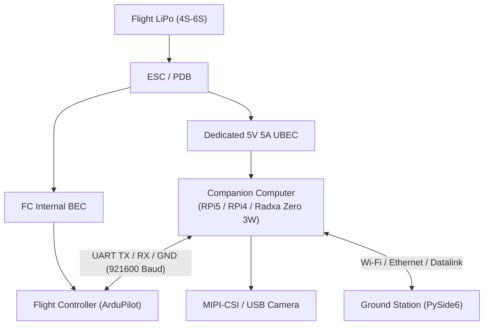

Viewed hardware-wiring.md:1-23
Created HARDWARE_AND_USER_GUIDE.md
Viewed hardware-wiring.md:1-23
Edited hardware-wiring.md
Ran command: `python -m pytest`

I have created a comprehensive hardware wiring and user operation guide in [docs/HARDWARE_AND_USER_GUIDE.md](file:///c:/Utsav/JS-aerial/InterceptorV2/docs/HARDWARE_AND_USER_GUIDE.md).

Here is a quick summary covering your specific boards:

---

### 1. Board-Specific Comparison & Circuit Diagrams




```
flowchart TD
    BATT["Flight LiPo Battery<br/>(4S–6S)"]

    subgraph POWER["Power Distribution"]
        PDB["ESC / Power Distribution Board"]
        UBEC["Dedicated 5V 5A UBEC"]
        FC_BEC["Flight Controller Internal BEC"]
    end

    subgraph FLIGHT["Flight Control System"]
        FC["Flight Controller<br/>(ArduPilot)"]
    end

    subgraph COMPANION["Companion Computer System"]
        SBC["Companion Computer<br/>(Raspberry Pi 5 / Pi 4 / Radxa Zero 3W)"]
        CAM["MIPI-CSI / USB Camera"]
    end

    GCS["Ground Control Station<br/>(PySide6 Application)"]

    BATT --> PDB
    PDB --> UBEC
    PDB --> FC_BEC

    FC_BEC --> FC
    UBEC --> SBC

    SBC <-->|"UART TX / RX / GND<br/>921600 baud"| FC
    CAM --> SBC
    SBC <-->|"Wi-Fi / Ethernet / Datalink"| GCS

    classDef power fill:#FFF0F0,stroke:#C62828,color:#222,stroke-width:1.5px
    classDef flight fill:#E8F0FE,stroke:#2563EB,color:#222,stroke-width:1.5px
    classDef companion fill:#F0E8FF,stroke:#7C3AED,color:#222,stroke-width:1.5px
    classDef ground fill:#E8F7EE,stroke:#238636,color:#222,stroke-width:1.5px

    class BATT,PDB,UBEC,FC_BEC power
    class FC flight
    class SBC,CAM companion
    class GCS ground
```

> [!CAUTION]
> **Power Safety Rule:** Always connect a common ground between the FC and your companion SBC, but **never connect the FC's 5V output to the SBC**. Power the companion SBC strictly through a dedicated 5V 3A–5A step-down UBEC directly from the flight battery to prevent ground loops and brownouts.

---

### 2. Pinout & Port Details for Your Boards

| Feature | **Raspberry Pi 5** *(Flagship)* | **Raspberry Pi 4B** *(Mid-Tier)* | **Radxa Zero 3W** *(Ultralight)* |
|---|---|---|---|
| **Form Factor** | Standard (85 × 56 mm) | Standard (85 × 56 mm) | Ultra-compact (65 × 30 mm) |
| **NPU / Accelerator** | **Hailo-8 / 8L** via M.2 HAT+ (30+ FPS YOLOv8) | CPU ONNX or Coral USB accelerator | Integrated 0.8 TOPS NPU (RK3566) |
| **5V Power Input** | Pin 2 & 4 (5V), Pin 6 (GND) — 5V 5A | Pin 2 & 4 (5V), Pin 6 (GND) — 5V 3A | Pin 2 & 4 (5V), Pin 6 (GND) — 5V 2A |
| **UART TX (to FC RX)**| **GPIO 14** (Pin 8) | **GPIO 14** (Pin 8) | **GPIO0_C0** (Pin 8) or UART3 (Pin 15) |
| **UART RX (from FC TX)**| **GPIO 15** (Pin 10) | **GPIO 15** (Pin 10) | **GPIO0_C1** (Pin 10) or UART3 (Pin 16) |
| **Linux Serial Device**| `/dev/ttyAMA0` | `/dev/serial0` (or `/dev/ttyAMA0`) | `/dev/ttyS3` (or `/dev/ttyS0`) |
| **Camera Interface** | Dual 22-pin MIPI CSI (`CAM0`) | 15-pin CSI-2 connector | 4-lane MIPI CSI ribbon |
| **Air-Unit Config** | `source: picamera2` | `source: picamera2` or `v4l2` | `source: v4l2` |

---

### 3. ArduPilot Parameter Configuration (Mission Planner)

On your flight controller's TELEM port:
- `SERIALx_PROTOCOL = 2` (MAVLink 2)
- `SERIALx_BAUD = 921` (921600 baud)
- `BRD_SERx_RTSCTS = 0` (Disabled flow control)

---

### 4. How to Use the System (Step-by-Step)

#### Step 1: Bench / Laptop Simulation (Zero Hardware)
Test the entire vision, tracking, and control loop without flying:
```bash
# Terminal 1: Launch SITL simulator
bash air-unit/sim/sitl_runner.sh

# Terminal 2: Run Air-Unit in simulation mode
python air-unit/main.py --sim

# Terminal 3: Run the Ground Station HUD
python ground-station/main.py
```
- A synthetic target will appear on the video canvas.
- Tap the target: the drone locks on (`FOLLOWING`) and computes real-time setpoints.

#### Step 2: Real Flight Operation
1. **Power Up**: Turn on the Ground Station PC/tablet, then connect the drone battery. Wait for the companion SBC to boot (~25s).
2. **Verify HUD**: In [ground-station/main.py](file:///c:/Utsav/JS-aerial/InterceptorV2/ground-station/main.py), confirm 30 FPS video, latency < 100 ms, and telemetry state `IDLE`.
3. **Takeoff (Manual RC)**: Arm and take off in `LOITER` or `ALT_HOLD` via your RC transmitter.
4. **Engage Autonomous Tracking**:
   - Orient the drone camera towards the target.
   - Switch your RC flight mode switch to **`GUIDED`**.
   - **Tap the target** on the ground station touchscreen or video window.
   - The HUD lock turns green (`FOLLOWING`), and the drone tracks the target autonomously.
5. **Instant Pilot Override (Rule S6)**:
   - At any second, flick your RC mode switch back to **`ALT_HOLD`** or **`LOITER`**. The companion computer halts setpoints in < 10ms and gives you immediate manual control.

Full details, board overlays, camera calibration, and systemd service templates are documented in [docs/HARDWARE_AND_USER_GUIDE.md](file:///c:/Utsav/JS-aerial/InterceptorV2/docs/HARDWARE_AND_USER_GUIDE.md).